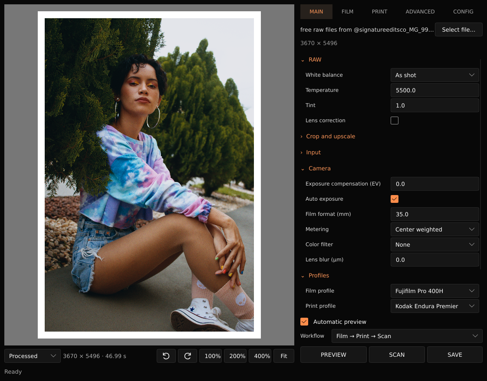
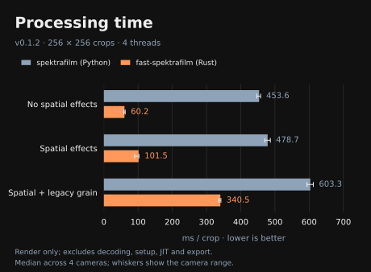
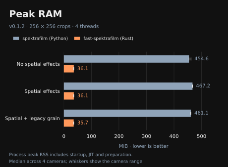
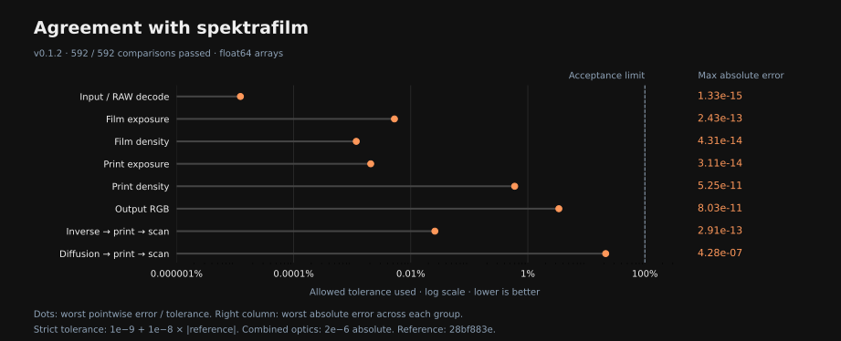

<div align="center">

# fast-spektrafilm

*(по крайней мере, мне кажется, что он быстрее)*

[](https://github.com/dmitryprikhunov/fast-spektrafilm/releases/latest)
[](RELEASES.md)
[](LICENSE)

[🇬🇧 English](README.md)

Симуляция фотоплёнки и фотопечати для RAW- и RGB-изображений: библиотека на Rust,
CLI и десктопное приложение на Slint. Изображение проходит через экспонирование
плёнки, проявку, печать и сканирование с настройками цвета, зерна и оптических
эффектов.

Основано на [spektrafilm](https://github.com/andreavolpato/spektrafilm/tree/28bf883e1672e884307edc75852549376e13644e)
**Андреа Вольпато (Andrea Volpato) и участников проекта spektrafilm**. Исходные
сведения об авторстве, данные и лицензии сохранены; этот порт распространяется
под GPLv3.



Фотография в превью взята из
[коллекции бесплатных RAW-фотографий Signature Edits](https://www.signatureedits.com/free-raw-photos/).
Она принадлежит её автору, а не проекту fast-spektrafilm.

## Бенчмарки

<p>
  
  
</p>



Кропы 256×256 · 4 потока · [Методика и данные](docs/benchmarks/v0.1.2/README.md)

## Начало работы

Готовые сборки CLI и десктопного приложения для Linux x86_64 доступны в
[GitHub Releases](https://github.com/dmitryprikhunov/fast-spektrafilm/releases).
Инструкции по установке и требования к системе — в [RELEASES.md](RELEASES.md).

Для сборки из исходников ознакомьтесь с требованиями в
[DEVELOPMENT.md](DEVELOPMENT.md), затем выполните из корня репозитория:

<div align="left">

```sh
# Десктопное приложение
cargo run --release --locked --features gui --bin fast-spektrafilm-gui

# Командная строка
cargo run --release --locked -- process input.tiff output.tiff
```

</div>

Откройте изображение, настройте обработку с помощью **Preview**, затем нажмите
**Scan** для обработки в полном разрешении. **Save** использует готовый результат
сканирования, если настройки не изменились. Число потоков процессора выбирается
автоматически; ограничить его можно параметром `--threads N`.

Поддерживаются RAW, PNG, JPEG, TIFF, WebP, EXR и RGB NPY. Десктопное приложение и
CLI используют общие настройки обработки в формате JSON.

Дополнительная документация на английском:

[Руководство по приложению](GUI.md) · [Сборка, CLI и библиотека](DEVELOPMENT.md) ·
[Состояние переноса и технический долг](MIGRATION.md) · [Проверка точности](VALIDATION.md) ·
[Участие в разработке](CONTRIBUTING.md) · [Бенчмарки](BENCHMARKS.md) · [Лицензия](LICENSE)

Продукт включает программное обеспечение, разработанное Чикагским университетом
как оператором Аргоннской национальной лаборатории (MINPACK). Сведения об
авторстве и лицензионные уведомления для арифметики SciPy и OpenBLAS, а также
CORE-MATH сохранены в [licenses/](licenses).

</div>
