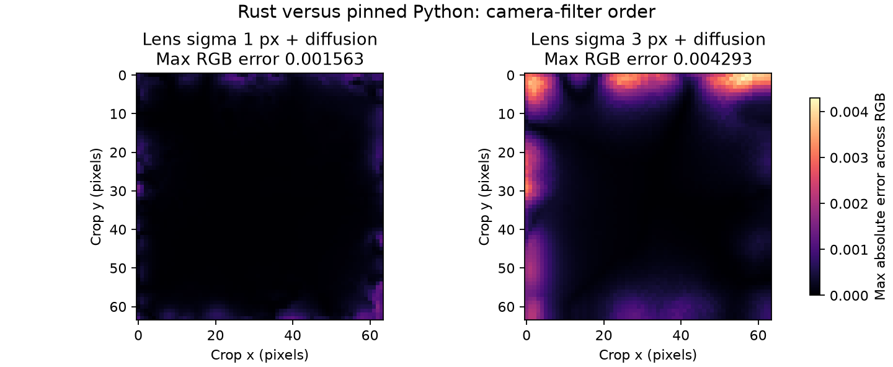

# Numerical and algorithm review — 2026-10-14

**Review target:** Rust `b47ce1ff7d7e365ef279b177f3c75c2dd2f3d3be`, on
`codex/numerical-review-plan`. **Reference:** experimental
`28bf883e1672e884307edc75852549376e13644e`, extracted under `.reference/`.
The sibling checkout's current HEAD is different and was not used as the oracle.
All 235 copied assets, derived tables, and extracted reference sources passed
`tools/check_baseline.py --require-reference`. No processing implementation,
measurement assets, or original-repository files were changed for this review.
Pre-existing changes to `DEVELOPMENT.md` and `tools/recreate_dye_clouds.py` are
outside this work.

## Assessment

The forward implementation is a close port, with deliberate preservation of
rounding and reduction order. However, passing the existing fixtures does not
establish strict parity for combinations of supported features. New cached-RAW
probes reproduce three correctness issues:

| Priority | Finding | Measured evidence | Task |
|---|---|---|---|
| P1 | Camera lens blur and diffusion execute in reversed order | RGB max error **0.00429285**, RMSE **0.000519352**; optical allowance is 2e-6 | T1 |
| P1 | Convert LUT is built with different scalar/batch arithmetic and stopping behavior | At 32³, CMY max error **1.63900e-4**, RMSE **5.17019e-6**, exceeding the 2e-5 inverse/LUT allowance | T2 |
| P2 | Unseeded convert-film glare uses a fixed seed | Two independent Rust renders are identical; Python renders vary | T3 |

The LUT result compares **Rust LUT to Python LUT at the same resolution**, not
LUT interpolation to direct integration. It is a port discrepancy, separate
from the reference LUT's inherent approximation. Diffusion alone also does not
meet the forward float64 gate, but stays within its existing, explicitly looser
optical gate on these probes. Do not describe the entire implementation as
meeting one universal float64 tolerance.

The optimization priorities are preparation reuse, bounded FFT workspaces,
inverse-solver temporary storage, and spatial/grain buffer traffic. Proposed
speedups below are hypotheses until implemented and measured; memory formulas
are explicitly distinguished from measured process RSS.

## Numerical contract and evidence

The release library/CLI suite passed **28 tests**, with **two optional native
tests ignored** (metadata and Lensfun). A fresh broad Python run passed **590
stage/decoder comparisons**, including all copied film/print profiles and four
cached 256×256 RAW crops. Its maximum error was **8.02678e-11**, chemistry RGB,
with RMSE **1.00020e-11**. All ten controlled grain-density comparisons reported
bitwise equality. These successful tests coexist with the new failures because
the new probes exercise combinations/settings absent from that sweep.
The diagnostic Rust example built and passed Clippy with `-D warnings`;
repository Rust formatting, diff whitespace and Python syntax checks passed.

The strict deterministic contract is elementwise
`abs(actual-reference) <= 1e-9 + 1e-8*abs(reference)` on equal-shaped finite arrays.
Float64 containers alone do not satisfy that contract. Grain intentionally stores
some values in float32; inverse conversion intentionally mixes float32 and
float64; diffusion intentionally uses float32 FFT work arrays in the reference.

Existing allowances are 3e-7 for standalone diffusion, 2e-6 for optical paths,
2e-5 for inverse routes/LUT, and 2e-4 for arbitrary inverse inputs. Calibration
tests permit 1e-4 coefficients/output and 1e-5 residuals even though current
measured differences are many orders smaller. See T4 for a contract that makes
these distinctions enforceable.

New probes use `[96:160,96:160]` from the cached 256×256 center crop of
`samples/RAW_CANON_EOS_5DMARK3.CR2`. They contain 12,288 RGB components. Optical
tests use Portra 400 → Portra Endura → encoded sRGB, 0.375 mm over 64 pixels
(5.859375 µm/pixel), autoexposure/stochastic effects off, halation off, default
couplers/scanning, Black Pro-Mist strength 1.0. These are identical settings in
both implementations; the physical window is a deliberate filter stress test.
The final inverse probes use spatial/stochastic effects off and identity
calibration unless explicitly marked otherwise.

| Probe | Tap | Max absolute error | RMSE | Components failing strict gate |
|---|---|---:|---:|---:|
| Lens blur only, sigma 1 px | RGB | 2.33702e-14 | 5.09484e-15 | 0 |
| Lens blur only, sigma 3 px | RGB | 2.23155e-14 | 4.56380e-15 | 0 |
| Camera diffusion only | RGB | 1.11463e-7 | 1.51027e-8 | 8,315 |
| Camera diffusion + lens sigma 1 px | Film log exposure | 3.85629e-3 | 4.77132e-4 | 12,288 |
| Camera diffusion + lens sigma 1 px | RGB | 1.56272e-3 | 1.51124e-4 | 12,288 |
| Camera diffusion + lens sigma 3 px | Film log exposure | 1.15331e-2 | 1.67162e-3 | 12,288 |
| Camera diffusion + lens sigma 3 px | RGB | 4.29285e-3 | 5.19352e-4 | 12,287 |
| Direct inverse, nonidentity calibration | CMY | 0 | 0 | 0 |
| Direct inverse, nonidentity calibration | RGB | 2.89352e-13 | 5.60615e-14 | 0 |
| Inverse LUT 9³, identity | CMY | 9.43215e-6 | 4.06497e-7 | 6,531 |
| Inverse LUT 17³, identity | CMY | 2.08786e-5 | 1.06870e-6 | 8,527 |
| Inverse LUT 32³, identity | CMY | 1.63900e-4 | 5.17019e-6 | 9,367 |
| Inverse LUT 32³, identity | RGB | 1.47133e-5 | 9.93386e-7 | 9,330 |



Exact configs, worst component coordinates/values, tolerance ratios, and machine
provenance are retained in [the evidence JSON](numerical-2026-10-14-evidence.json). Large arrays and logs
remain under ignored `artifacts/numerical-review/`. The figure is a measured
error map, not a simulation or visual judgment of acceptable accuracy.

## Isolated timing and memory measurements

Measured after compilation and validation completed, on an Intel Xeon E5-2680
v4 @ 2.40 GHz, Rust 1.93.1, Python 3.13.16. The same cached Canon **256×256**
ProPhoto-linear crop, Portra 400 → Portra Endura → encoded sRGB, four threads,
autoexposure off, default gamut handling and direct spectral integration are
used in both processors. `fine` means a 1.5 mm crop window / 5.859375 µm spacing;
otherwise 35 mm / 136.71875 µm. Legacy grain uses `use_fast_stats=false`, glare
off; other rows disable stochastic effects. Diffusion enables the default
Black Pro-Mist in camera and enlarger plus stock spatial effects, with camera
lens blur at its zero default. Forward/inverse rows disable spatial effects.

One full **cached-crop** warmup precedes three measured renders per processor.
The table gives medians; arrays in the evidence retain the warmup and all raw
samples. Reading/RAW decoding, setup/JIT warmup, Rust repetition input cloning
and output writing are outside the render timer. Python's internal preprocessing
copies remain part of its timed `process` call. RSS is `/usr/bin/time` peak for
each process including imports, preparation, warmup and retained buffers. It is
not pixel-buffer allocation accounting or the combined footprint of the harness.

| Mode | Rust ms | Python ms | Python/Rust | Rust RSS MiB | Python RSS MiB | Max RGB error | RGB RMSE |
|---|---:|---:|---:|---:|---:|---:|---:|
| Forward deterministic, 35 mm | 60.13 | 459.37 | 7.64× | 34.65 | 467.40 | 2.12018e-14 | 8.23333e-16 |
| Spatial, fine | 202.63 | 487.63 | 2.41× | 34.18 | 459.54 | 6.42264e-14 | 1.15028e-14 |
| Spatial + legacy grain, fine | 400.08 | 635.21 | 1.59× | 34.61 | 463.22 | 4.38538e-15 | 7.88680e-16 |
| Camera + enlarger diffusion, 35 mm | 326.09 | 523.46 | 1.61× | 34.62 | 460.03 | 6.53482e-7 | 3.94082e-8 |
| Camera + enlarger diffusion, fine | 581.35 | 588.33 | 1.01× | 34.66 | 468.55 | 1.06237e-7 | 1.52790e-8 |
| Direct inverse → print → scan, 35 mm | 746.13 | 2121.06 | 2.84× | 34.61 | 537.75 | 2.91375e-13 | 3.71574e-14 |

All outputs passed their existing path-specific gates. The diffusion rows fail
the strict forward gate: 171,689 and 137,383 components respectively exceed
`1e-9 + 1e-8*abs(reference)`. This is an explicit precision exception, not evidence
of universal strict parity. All six separate profiled runs exactly matched their
corresponding fused outputs on these settings.

Fine diffusion is effectively tied in this small sample: Rust ranged
562.84–581.95 ms and Python 583.22–588.56 ms; three repeats do not support a
general 1% speed claim. Forward ranged 59.29–60.14 / 456.31–459.55 ms; inverse
744.09–746.16 / 2099.63–2142.31 ms (Rust/Python). Fresh Rust simulator setup took
594–618 ms across these six processes, about **ten times** the forward render.
This is cold setup; warm GUI update savings remain to be measured.

Separate Rust profiling measured inverse conversion at **691.70 ms**, fine
diffusion film exposure at **212.83 ms** and print exposure at **221.25 ms**,
and grain-enabled film development at **227.24 ms** versus **38.45 ms** without
grain at fine spacing. These identify useful targets, but stage measurements
use a materializing executor and are not additive percentages of fused medians.

No full-resolution simulation was run for this review. The earlier full-RAW
numbers in [BENCHMARKS.md](../../BENCHMARKS.md) are historical context from a
different source revision, not new measurements here. The capacity estimates in
T6/T8 explain why tiny-crop RSS must not be extrapolated to full images.

## Algorithm audit

| Area | Current algorithm and fidelity | Review consequence |
|---|---|---|
| Spectral exposure | Copied spectral LUTs, 81-wavelength projection, Mitchell cubic reconstruction, reference adaptation/gamut rules | Keep float64 wavelength summation order and original LUTs; cache preparation rather than replacing the model |
| Development/chemistry | Model-derived Gaussian/septic curves, gamma/exhaustion morphing, linear density interpolation, DIR donor/receiver correction | Existing tested variants agree closely; preserve curve normalization and exposure-anchor ordering |
| Print/scan | Direct Beer–Lambert spectral integration, optional tetrahedral/1-D LUTs, scanner anchors, output gamut/transfer functions | Fused forward path is efficient; test LUT parity separately from LUT approximation to the direct model |
| Spatial filtering | Separable FIR below sigma 3; Young–van Vliet IIR at/above 3; three-Gaussian exponential mixture | These approximations are in the Python baseline too. Replacing them with an analytic Gaussian/exponential would change the model |
| Optical diffusion | Reference three-component PSF mixture and float32 FFT convolution | Camera order is wrong; Rust complex FFT/power-of-two workspace differs from SciPy real FFT/fast lengths |
| Grain/glare | MT19937-compatible streams; legacy and fast samplers; float32 stores; NumPy-style pairwise sums; multiplicative USM | Covered controlled grain outputs match exactly. Preserve sampling order, signed counts, stores, and reduction tree during optimization |
| Inverse/calibration | Eight bounded damped Gauss–Newton iterations; mixed precision; pinned BLAS/LU arithmetic; MINPACK-style finite differences/LM | Direct probes are very accurate; scalar LUT bake does not preserve the batch problem. Optimizer changes need residual and fitted-output gates |
| Framing/preview | SciPy-like B-spline prefilter/cubic resampling; separate anti-aliased linear preview reducer | Preserve mirror/reflect distinctions, axis order, crop rounding, and physical pixel spacing |

The absence of new failures in a tested area is not an exhaustive proof for all
custom profiles, extreme values, or parameter combinations. This review focuses
on library/CLI math and algorithmic GUI-backend costs; it does not revalidate
interactive Slint layout, OS dialogs, every codec, or optional native integrations.

## Tasks

### T1 — P1: Restore camera optical-stage order

**Evidence.** `src/pipeline.rs:1029–1032` runs Gaussian lens blur before diffusion.
Pinned `runtime/stages/filming.py:47–56` runs highlight boost → diffusion → lens
blur → halation. These finite-domain filters cannot be freely exchanged:
diffusion uses reflected padding, FIR uses a different reflection convention,
IIR has replicated boundary states, and diffusion casts to float32. Errors in
the figure cluster at boundaries but are not restricted to a single border pixel.

**Causal check.** Temporarily swapping the calls in the *loaded Python process*
to imitate Rust reduces film-log-exposure disagreement from 0.00385629 to
1.39738e-7 at sigma 1, and from 0.0115331 to 9.10791e-8 at sigma 3. No reference
files were edited; this altered-order run is diagnostic, never an oracle fixture.

**Work.** Move camera diffusion ahead of camera lens blur; add combined-effect
fixtures and compare all five taps. Exercise both executors and mid-pipeline
injection where relevant. Do not relax tolerances to accommodate the old order.

**Sample.** Existing probe config `camera_both_sigma3`: camera
`film_format_mm=0.375`, `lens_blur_um=17.578125`, diffusion active/strength 1.0.
Also test sigma `2.999999`, `3.0`, `3.000001`, all four filter families, BW and
reversal stock, edge/highlight crops and odd dimensions.

**Done when.** Combined optical paths meet 2e-6 and the chosen tighter per-stage
diffusion budget; blur-only cases still meet the strict gate. Document any
remaining FFT error independently. T1 precedes optical optimization.

### T2 — P1: Bake inverse LUTs with reference batch semantics

**Evidence.** `src/pipeline.rs:595–608` calls scalar `converter.invert` for each
LUT node. `src/convert.rs:257–313` selects different reduction arithmetic for a
one-row solve and tests convergence over the supplied batch. Python
`utils/lut.py:13–27` builds all nodes and calls the inverse once; its
`model/convert.py:228–241` uses a global residual maximum before each update.
Scalar early stopping and batch early stopping are different computations.

The diagnostic example evaluates exactly the same reference-generated 9³ grid:
Rust **batch error is zero**; scalar max error is **1.88369e-5** (RMSE
**6.36848e-7**, 303 components fail the strict gate). Rust's computed gamut
bounds additionally differ by **7.22159e-10**: its `gamut_bounds` uses scalar
float64 `scan`, while Python samples float32 CMY through its batch forward map.
Nonidentity calibration also takes the scalar pretransform on the Rust LUT
path (`pipeline.rs:886–891`, `convert.rs:315–330`) versus batch multiplication
in Python. These are separate audit targets; the experiment does not attribute
the entire final error to any one of them.

**Work.** Match reference gamut-grid construction, working precision and batch
forward evaluation; bake inverse nodes as one logical batch; use consistent
calibration pretransform arithmetic. Preserve global convergence and odd-final-row
BLAS semantics even if physical storage is chunked. Add tests at node values
before testing interpolation.

**Samples.** Identity 9³/17³/32³ plus even/odd grids; the nonidentity matrix
`[[1.07,-0.03,0.012],[0.017,0.94,-0.021],[-0.011,0.025,1.04]]`;
dark/high-density values, clipped nodes, altered base/illuminant, single-pixel
and odd-sized images. Worst 32³ crop density: `(y=51,x=63,c=2)`, Rust
`1.9477332318350784`, Python `1.9478971318095877`.

**Done when.** Same-grid inverse nodes meet the strict contract on the pinned
environment, same-resolution Rust/Python LUT outputs pass the declared gate,
and LUT-versus-direct approximation is reported separately. At minimum the
existing 2e-5 CMY gate must pass without increasing it. Tighten it after the
batch-preserving implementation is measured.

### T3 — P2: Unify seed selection across routes/executors

**Evidence.** `src/pipeline.rs:902` uses `random_seed.unwrap_or(0)` for conversion.
Forward processing (`:970`) and profiled processing (`:685`) generate a fresh
seed when absent. With convert → print → scan, grain off, glare percent 10 and
roughness 1, separate Rust renders are bitwise identical, whereas Python varies.
Percent 10 exaggerates the probe; the fixed-seed control flow also affects any
positive stochastic glare amount. The profiled Rust path varies, so its
stochastic behavior also depends on executor choice.

**Work.** Choose one render seed at the common entry point and pass it through
all enabled stages. Make explicit-seed, missing-seed and legacy-seed semantics
part of the API contract; remove the route-specific fallback.

**Done when.** Unseeded repeated conversion varies; explicit-seed repeated
conversion is identical across 1/4 threads and fused/profiled execution;
controlled Python glare comparisons pass. Do not require arbitrary unseeded
Python and Rust renders to match pixel by pixel.

### T4 — P1: Turn numerical tolerances into regression protection

**Evidence.** `tests/core_coverage.rs:47–57` permits 2e-5/2e-4 for direct inverse
fixtures whose measured error is zero. `tests/debt.rs:48–63` permits 1e-4 fitted
coefficients/output and 1e-5 residuals; this run measured at most
3.27283e-12 coefficients and 1.83867e-12 residuals. Those bounds could hide
substantial regressions relative to today's implementation. `tools/validate.py`
records grain bit equality but does not assert that boolean; Rust tests cover
only the selected bitwise subsets/matrix.

**Work.** Define named per-stage contracts shared by tooling/tests. Enforce the
strict gate for direct inverse and calibrated output where the pinned evidence
supports it; retain measured absolute coefficient/residual bounds with modest
cross-run margin, rather than the historical 1e-4 ceiling. Give diffusion a
separate, explicit precision policy. Keep exact controlled grain comparisons.
Always report shape, finiteness, max error, RMSE, failing-element count, maximum
normalized tolerance ratio, and worst coordinates.

**Samples.** Test zero/near-zero, negative linear RGB, HDR highlights, transfer
breakpoints, LUT boundaries, degenerate calibration and 1/2/odd/even batches.
Validate output finiteness consistently: `process_profiled` validates final
images, while several `process_owned` return paths do not. Audit invalid numeric
settings at public API boundaries; this is a code-level robustness gap, not a
claim that ordinary crop settings produced nonfinite output in this review.

**Done when.** A deliberately perturbed direct inverse result of 1e-6 fails CI;
invalid outputs cannot silently pass a comparator; all precision exceptions name
their stage, range, reason, and supporting measurements. Never loosen a global
tolerance merely because arrays are stored as float64.

### T5 — P2: Add interaction coverage and distinguish executors

**Evidence.** Existing tests exercise camera diffusion and lens blur separately,
and the inverse LUT fixture uses a narrow input/settings set. The new failures
survive the current suite. `src/main.rs:213–232` times repeated fused execution
but runs only the last repetition through the profiled executor when
`--stage-timings` is set; those timings then share one `process_seconds` array.
`process_profiled` materializes stages and therefore is not a breakdown of the
fused runtime.

**Work.** Add a small risk-based pairwise matrix: diffusion×lens blur,
grain×chemistry, scanner anchors×LUT×base, conversion×calibration×LUT, and
crop/upscale×physical spacing. Test fused/profiled/injection equality under
explicit seeds. Use one executor consistently for a reported timing series, or
label executor and warmup status on each sample.

**Done when.** T1–T3 regressions are in normal CI; every advertised stage has a
clear contract/fixture mapping; profiled stage sums are never presented as fused
hotspot percentages. Keep random/generated edge cases small and use cached RAW
crops for real-image evidence.

### T6 — P2: Reduce optical FFT memory and repeated setup

**Evidence.** `src/diffusion.rs:196–231` rounds both dimensions to powers of two,
holds two full complex64 planes, constructs the kernel/planner on every call,
and executes three channels sequentially. `fft2` calls convenience `process`
per row/column rather than supplying reusable scratch. Python's
`model/diffusion.py:717–731` uses float32 real FFT convolution.

**Analytical capacity example, not a measured full-frame benchmark.** At
6000×4000, 35 mm, default Black Pro-Mist sizes, radius is 1303, PSF is 2607²,
and both FFT dimensions become 16384. The two complex64 planes alone require
**4.00 GiB**; the float64 three-channel PSF adds **155.56 MiB**. One RGB64 frame
is **549.32 MiB**. Additional live pipeline buffers/scratch are not included.

**Work.** First reuse planner, per-worker FFT scratch and PSF/transform data
keyed by dimensions, pixel spacing and all shape parameters. Avoid cloning an
image when an owned no-op diffusion call can return it. Then evaluate real FFTs
and suitable smooth transform sizes. Start with allocation reductions that
preserve arithmetic; changing FFT lengths/backends needs a fresh numerical gate.
Bound caches by bytes. Do not parallelize three huge channel workspaces without
a memory budget. Tiled overlap-save is a later option only with the same global
PSF truncation and boundary treatment.

**Samples/done.** Benchmark four families, 35/1.5 mm cached crops, rectangular and
odd sizes, strengths/overrides, edge highlights and HDR. Require no regression
in optical error limits, report process RSS and workspace bytes separately,
and prove cache invalidation for every relevant parameter. T1 must land first.

### T7 — P2: Make FIR/IIR filtering cache-efficient without changing math

**Evidence.** `src/spatial.rs:25–136` gathers each channel into a float64 plane;
FIR allocates a full temporary plane and a `Vec<Vec<usize>>` of reflected x
indices. The IIR horizontal pass is parallel, but the strided vertical pass is
serial. Python `utils/fast_gaussian_filter.py:50–109,174–208` already uses
16-row FIR strips and parallel contiguous 32-column IIR chunks.

**Work.** Port the scheduling/layout ideas: reflected edges plus an interior
loop, strip scratch reused per worker, and independent contiguous column blocks
for vertical IIR. Retain vertical-before-horizontal FIR order, replicated IIR
states, the sigma-3 dispatch, and every float32 store in grain filtering.

**Done when.** Sigma sweeps around 0, radius-rounding points and 3 pass float64
and bitwise grain tests; thread counts 1/2/4 agree; sample-crop filter time and
scratch memory both improve. Do not silently replace the reference IIR with a
different Gaussian approximation or enable global fast-math/FMA reassociation.

### T8 — P2: Bound inverse-solver temporaries while retaining global stopping

**Evidence.** `src/convert.rs:257–309` allocates a full-image vector of RGB and
3×3 Jacobians on each Newton iteration. That vector costs **96 bytes/pixel**;
at 24 million pixels it is **2.146 GiB** alone. Input, cloned output, target RGB,
current density and this vector total approximately **180 bytes/pixel / 4.023
GiB**, excluding allocator overhead, other buffers and GUI retention. These
are source-derived capacity estimates, not measured RSS.

**Work.** Reuse allocations first. Evaluate chunks that retain old densities
until the *global* stop decision: either a second evaluation pass after a global
residual reduction, or a candidate-density buffer committed only if the global
residual requires another iteration. Preserve total-batch classification and
odd final row, initial float32 multiplication, damping, and pinned LU arithmetic.
Avoid the tempting independent-tile early exits: T2 demonstrates why they alter
results. Expose an owned conversion entry point to reuse the input buffer.

**Done when.** Direct/inverse/calibration fixtures and same-grid tests meet T4;
peak memory scales with bounded Jacobian scratch; added arithmetic versus saved
memory is measured at identical settings. Calibration must retain the same
residual function and stopping behavior. Do not substitute a different solver.

### T9 — P2: Keep grain scratch in its actual working precision

**Evidence.** `src/grain.rs:131–187` stores float32 layer values in a float64
`Image`; it retains probability/saturation/count arrays through layer blur.
`src/grain.rs:206–228` clones a full positive density image and blurs into
another full image for multiplicative USM. A scalar plane at 24 MP occupies
183.11 MiB in f64 versus 91.55 MiB in f32. Current outputs already quantize these
specific layer stores to f32, so a specialized plane can reduce storage without
reducing the intended model's precision.

**Work.** Add f32 scratch-plane/filter support with the same f64 accumulators
where required, reusable probability/count buffers and explicit early release
of completed arrays. Preserve all Poisson draws before binomial draws within
each layer, layer/channel seeds, int32 fast-count wrap, and the eight-lane
pairwise sum. Do not replace the samplers or reorder them per tile.

**Done when.** All controlled grain densities remain bitwise equal, including
microstructure, the one-pixel overflow case and multiple thread counts; report
memory and stage time with stock presets actually resolved. Keep any looser
statistical test supplementary to exact controlled-seed parity.

### T10 — P2: Reuse preparation and split preset resolution from simulation

**Evidence.** `Simulator::new` reloads color/profile/spectral data and prepares
response tables; `update` at `src/pipeline.rs:645` rebuilds the simulator.
`src/gui/backend.rs:250–281` computes a resolved scan-cache key by constructing
another simulator, after a render already constructed one. `resolved_params`
and `validate_params` also build full simulators. The existing global gamut
table cache helps that table only. These behaviors explain why fast fused crop
processing does not automatically produce a fast interactive workflow.

**Work.** Separate inexpensive parameter/preset digestion, immutable shared
assets, derived optical/spectral tables and per-render buffers. Cache immutable
assets by data identity/hash; cache derived tables by exact effective settings.
Reuse the resolved settings from the rendering simulator for cache keys. Add
selective invalidation without sacrificing atomic failed updates. Bound caches
by bytes, and keep processing/display/delivery keys distinct.

**Samples/done.** Compare fresh construction against every update class:
exposure, film/base/chemistry, lens/filter, gamut, LUT, dimensions, seed and output
delivery settings. Require identical output at fixed seeds and unchanged state
after failed updates. Measure cold setup, warm updates, Preview, Scan and cached
Save independently. Do not advertise a GUI speedup based only on core timers.

### T11 — P2: Remove avoidable full-frame copies and tiny heap allocations

**Evidence.** `src/pipeline.rs:1107` clones film log exposure into density;
`:804` and `:1201` allocate `v.to_vec()` per pixel for at most three density
channels. The spatial executor materializes film density even when downstream
operations are independent per pixel. Disabled diffusion also clones its input
(`src/diffusion.rs:82`). Input validation scans finite values twice in
`process_owned`. At 24 MP, each avoidable RGB64 clone is about 549.32 MiB of
live data plus memory traffic.

**Work.** Replace tiny allocations with stack arrays; add owned/in-place no-op
paths; reuse buffers when the prior tap is dead; fuse only pointwise stages
between spatial barriers. Keep an explicit reference-like stage executor for
diagnostics. Preserve operation order and intermediate quantization, and do not
remove required validation merely to improve a timer.

**Done when.** Fused/staged/injected outputs agree under the applicable contract;
allocation count and peak live bytes fall on identical cached crops; profiles
with one dye channel work. Review aliasing and lifetime assumptions before
reusing log-exposure buffers needed by couplers.

### T12 — P3: Optimize resize work after the dominant costs

**Evidence.** `src/framing.rs:95–143` scans every image element to identify line
starts before filtering each axis. `:197–215` performs a 4×4×4 stencil including
the channel axis, matching the source's multidimensional spline behavior.
`src/preview.rs:59–76` allocates two source-width rows for every output row.
These are concrete traffic/dispatch costs, but this review does not claim they
dominate the measured pipeline.

**Work.** Iterate explicit row/column/channel lines, reuse worker-local row
scratch, and investigate separable interpolation with the original reduction
order. Do not simply remove channel-axis prefiltering or change cubic to linear.
Keep RAW preview sampling bounded and verify against full decode followed by
the same reducer.

**Done when.** Odd/asymmetric crops, 1-pixel axes, upscale/downscale, sharp RGB
edges and metering-before-framing fixtures pass. Report preview/rescale time and
scratch memory separately; retain processing at the same physical pixel scale.

### T13 — P2: Make the evidence durable and benchmarks difficult to misread

**Evidence.** `.github/workflows/rust.yml` runs checked-in golden tests and
native integration checks, but not the full Python differential sweep. CI also
uses different release LTO/codegen settings from the documented local benchmark.
`tools/benchmark.py` uses `assert_allclose` without an explicit finite/shape gate
or input hash, and most detailed historical reports are ignored artifacts.

**Work.** Add a scheduled/on-demand pinned Python comparison job and commit
compact failing fixtures from T1–T3 to ordinary CI. Record compiler flags, CPU,
BLAS target/version, dependency versions, input/config/binary/asset hashes,
executor, warmups and measured repetitions. Fail comparisons on shape/nonfinite
values; emit separate port-error and LUT-approximation metrics. Use finite
checks before interpreting RSS/speedup results. Benchmark a crop-size series
and at least two physical spacings; preserve RAW-decoding caches and never run
full Python sample simulations by default.

**Done when.** A clean checkout can reproduce the review's compact evidence;
timing is isolated from builds/tests; confidence intervals or observed spread
are included before making small speed claims; process RSS is clearly separate
from buffer estimates. Full-frame capacity projections stay labeled as estimates
unless explicitly measured.

## Delivery order

1. T1–T3 correctness fixes, alongside T4/T5 fixtures and gates.
2. T10 preparation reuse and T11 low-risk allocation changes.
3. T6/T8 memory work, then T7/T9 hot-stage optimizations, each measured separately.
4. T12 after profiling demonstrates value; T13 evidence/CI work supports all steps.

Each implementation task should be an independently reviewable change with its
own numerical and timing report. Preserve measured data/licenses. No new profiles,
handwritten replacement LUTs, alternative stochastic models, global fast-math,
or default precision reductions are part of this plan.

## Reproduction

From the repository root, with the existing user-local reference environment:

```sh
python3 tools/check_baseline.py --require-reference
cargo test --release --locked -j4 -- --nocapture
cargo build --release --locked -j4
.venv/bin/python tools/validate.py --all-profiles --samples --decode \
  --spatial --variants --grain --spectral --gamut --lut --framing --crop-size 256
.venv/bin/python tools/review_numerics.py
cargo build --release --locked --example review_inverse -j4
.venv/bin/python tools/review_numerics.py --inverse-grid
# Run benchmarks only after the preceding work has completed.
.venv/bin/python tools/review_benchmark.py
```

The diagnostic scripts record known discrepancies without changing production
math. `review_inverse` evaluates source-generated grid data; it does not create
replacement measurement assets. No base-system packages are required beyond
the already configured build/reference environment.
